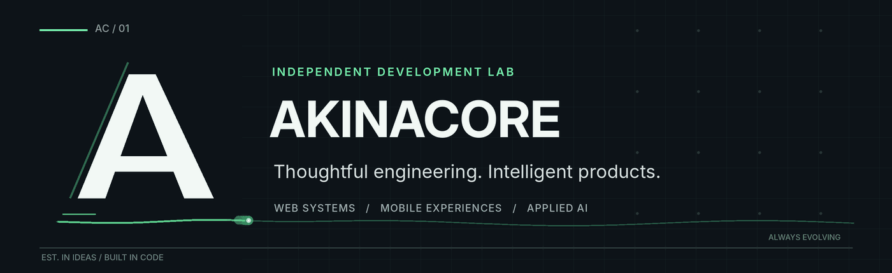

  <a href="https://github.com/AkinaCore?tab=repositories"><strong>Explore my work</strong></a>
  &nbsp;&nbsp;·&nbsp;&nbsp;
  <a href="#what-I-build">What I build</a>
  &nbsp;&nbsp;·&nbsp;&nbsp;
  <a href="#akina-approach">Akina's approach</a>
  &nbsp;&nbsp;·&nbsp;&nbsp;
  <a href="#the-toolkit">The toolkit</a>

 

## The idea behind the core

**AkinaCore is an independent space for driven by precision, grown from creative soil.**

I create and explore digital experiences across web, mobile, and AI. From the architecture behind a platform to the smallest interaction on a screen, I value solutions that are purposeful, understandable, and built to evolve.

> Good technology doesn't have to be loud. It's supposed to make a difference and make people's jobs easier.

 

## What Akina build

<table>
  <tr>
    <td width="50%" valign="top">
      <h3>01 &nbsp; / &nbsp; Web &amp; platforms</h3>
      
Full-stack applications, reliable APIs, modern dashboards, and the infrastructure that connects them.

      BACKEND SYSTEMS · WEB APPLICATIONS · INTEGRATIONS
    </td>
    <td width="50%" valign="top">
      <h3>02 &nbsp; / &nbsp; Mobile experiences</h3>
      
Useful, intuitive applications that translate complex requirements into natural everyday interactions.

      CROSS-PLATFORM APPS · UX-DRIVEN DEVELOPMENT
    </td>
  </tr>
  <tr>
    <td width="50%" valign="top">
      <h3>03 &nbsp; / &nbsp; Applied intelligence</h3>
      
Machine-learning experiments, AI-assisted workflows, and data-informed approaches to practical problems.

      MACHINE LEARNING · AUTOMATION · DATA
    </td>
    <td width="50%" valign="top">
      <h3>04 &nbsp; / &nbsp; Engineering experiments</h3>
      
Ideas, developer utilities, reusable components, and prototypes that help us learn by building.

      OPEN SOURCE · PROTOTYPING · DEVELOPER TOOLS
    </td>
  </tr>
</table>

 

## Akina's approach

I believe good products emerge from a clear problem, deliberate technical choices, and a willingness to iterate.

| **01 / Understand** | **02 / Engineer** | **03 / Evolve** |
| :--- | :--- | :--- |
| Start with people, context, and the real problem. | Design maintainable systems and focused experiences. | Measure, learn, simplify, and improve. |

**my north star:** clarity in design, care in implementation, curiosity in everything.

 

## Inside AkinaCore

This GitHub is a growing home for products, prototypes, and engineering explorations. The work spans three interconnected directions:

| Direction | What you'll find |
| :--- | :--- |
| **Products & platforms** | Applications, services, APIs, and end-to-end product work. |
| **Research & experiments** | AI/ML investigations, proof-of-concepts, and technical ideas in motion. |
| **Tools & building blocks** | Reusable components, automation, and developer-focused utilities. |

  <a href="https://github.com/AkinaCore?tab=repositories"><strong>Browse all repositories →</strong></a>

<!--
FEATURED PROJECTS / When public projects are ready, uncomment this section
and replace the sample information with REAL repository names and URLs.

### Selected projects
| Project | Description | Technologies |
| :--- | :--- | :--- |
| [Project name](https://github.com/AkinaCore/REPOSITORY) | What it solves. | Stack |
-->

 

## The toolkit

I choose technology to fit the problem rather than the other way around. Some of the tools and ecosystems we work with and explore:

| Focus | Technologies |
| :--- | :--- |
| **Interfaces** | Vue · Flutter · Dart · HTML/CSS |
| **Applications & services** | C# · ASP.NET Core · Python |
| **AI & data** | Python · scikit-learn · PyTorch |
| **Delivery & infrastructure** | Docker · Git · GitHub · Linux · Jenkins|

 

---

> *Where precise engineering navigates every sharp curve, and complex logic blossoms into simple, living ideas.*
---

  <i>© 2026 Akina. All rights reserved.</i>

